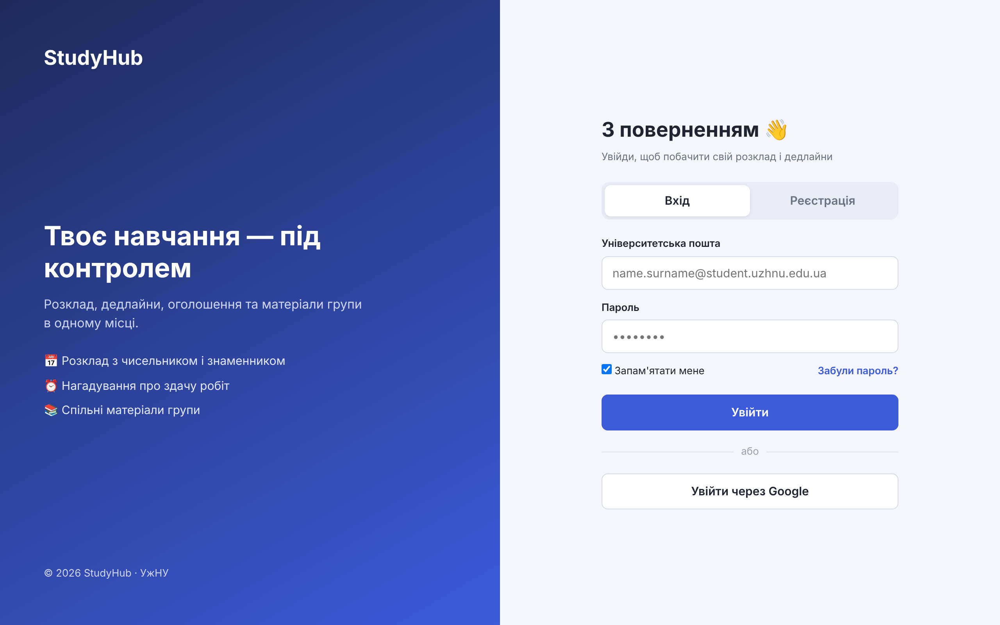
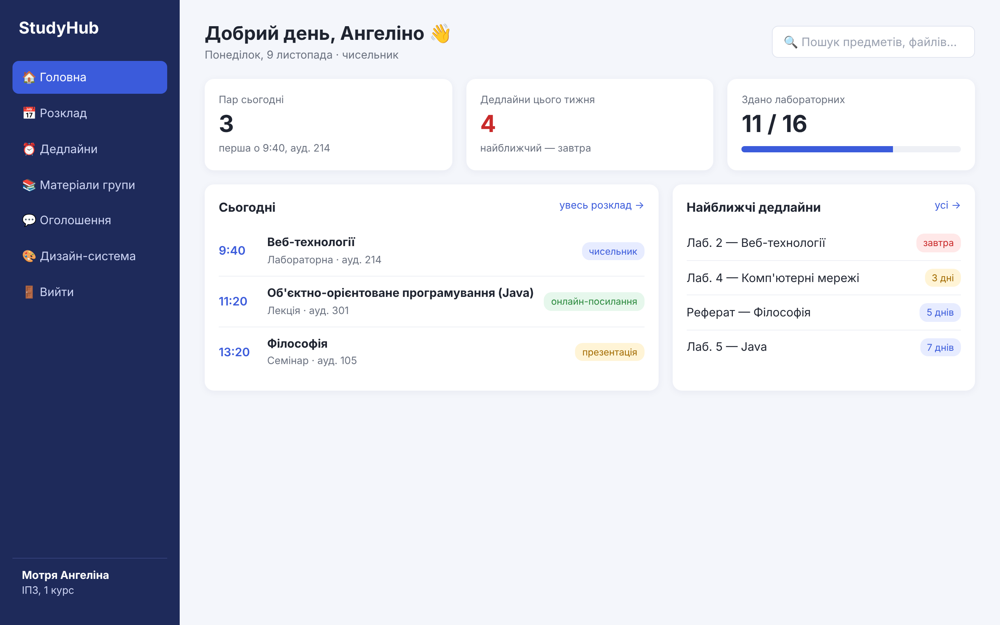
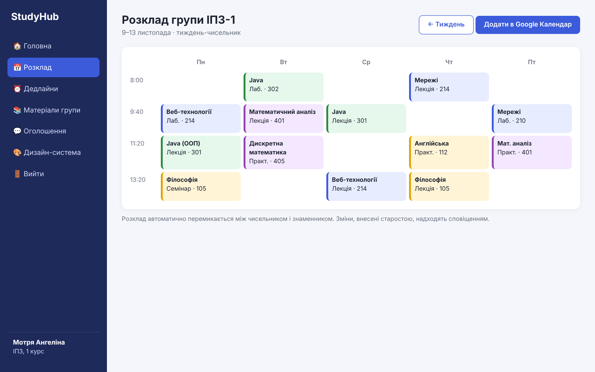
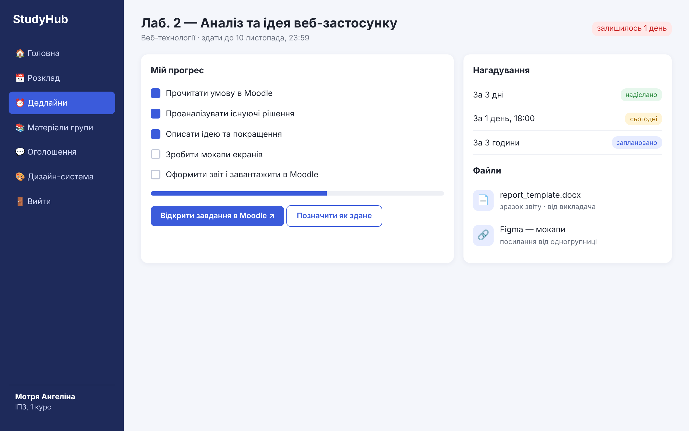
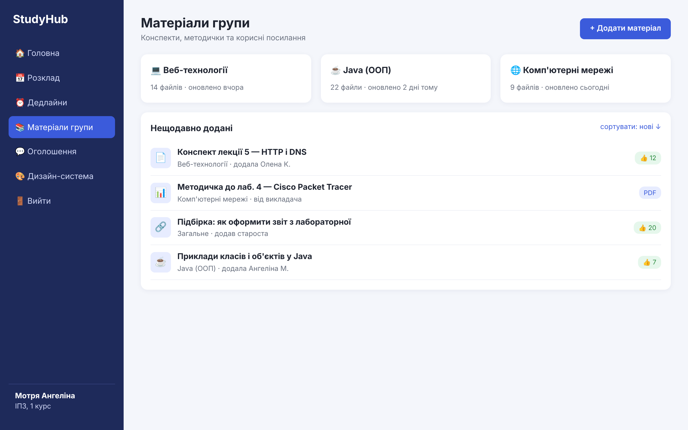
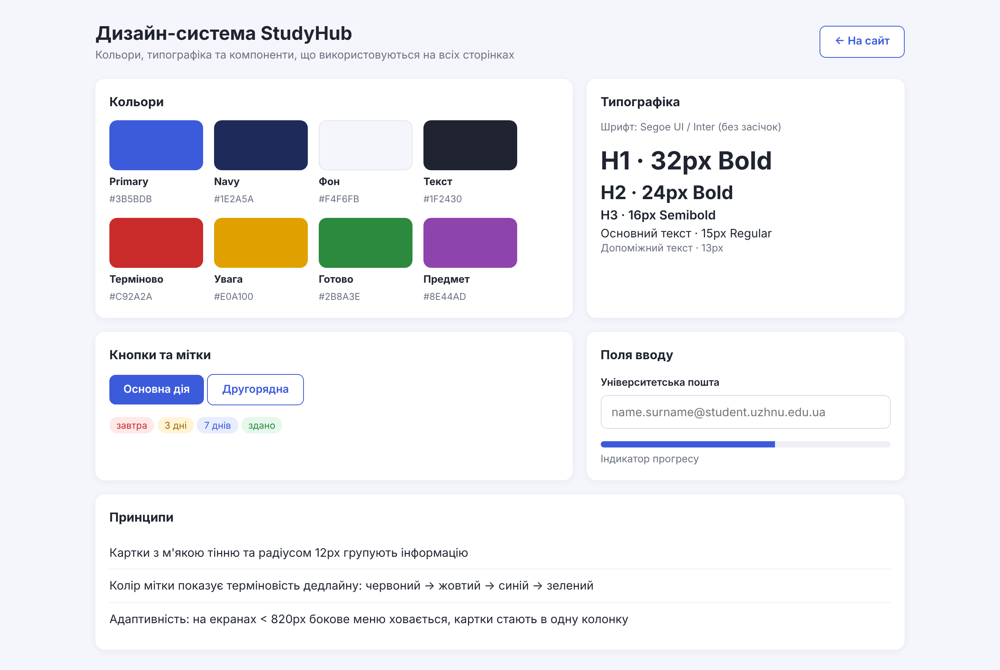
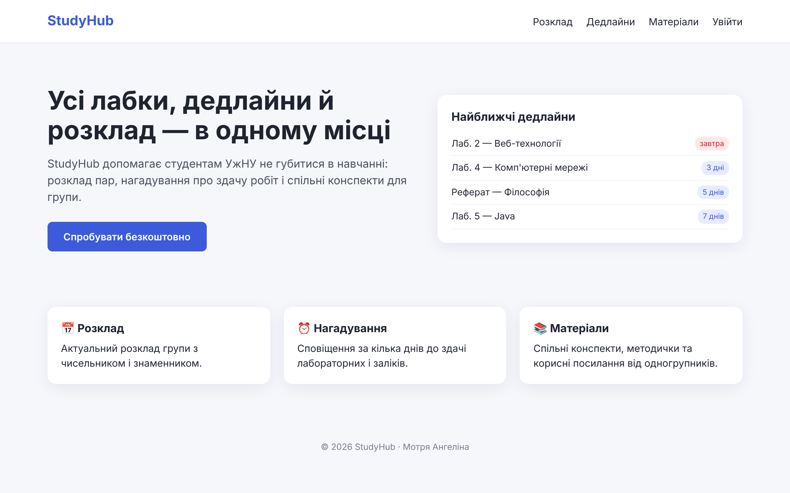
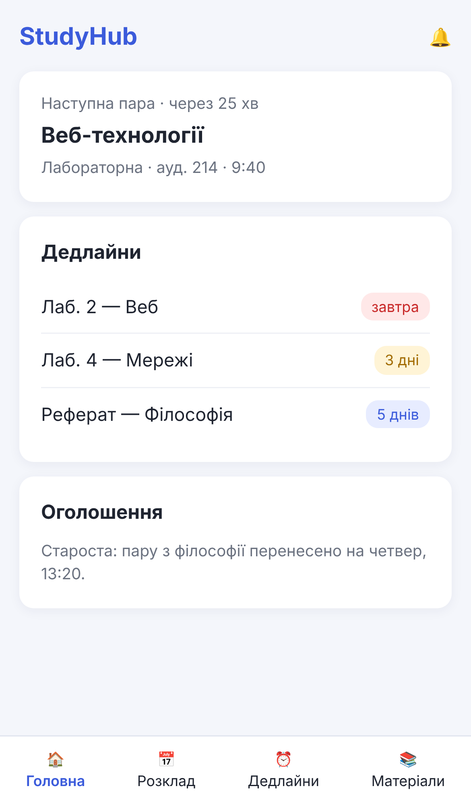
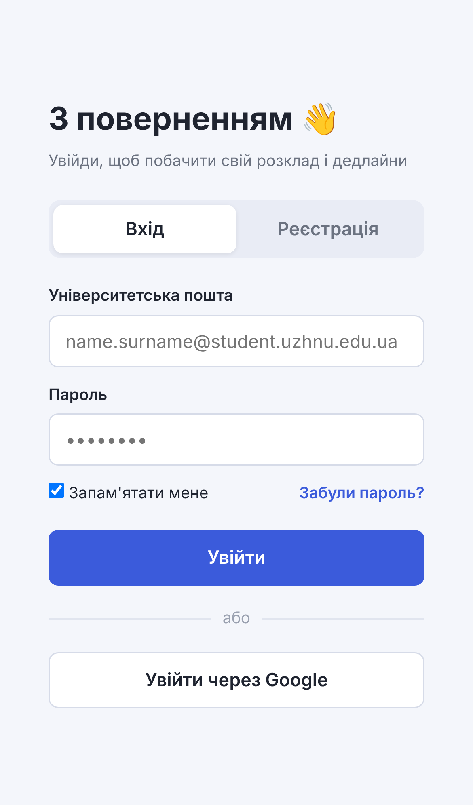

# StudyHub — дизайн веб-застосунку

**StudyHub** — помічник студента, який збирає розклад пар, дедлайни лабораторних, оголошення старости та матеріали групи в одному місці.

> Лабораторна робота 2 «Власна ідея веб-додатку. Ч2 — дизайн» (Веб-технології, УжНУ).
> Виконала: Мотря Ангеліна Васильівна, ІПЗ, І курс.
> Цей репозиторій містить лише **дизайн**; реалізацію на React буде виконано до кінця семестру.

## Проблема
Студенти користуються одразу кількома сервісами: Moodle (завдання), таблиця/фото розкладу, Telegram-чат групи (оголошення), нотатки в телефоні (дедлайни). Інформація розпорошена, важливі повідомлення губляться.

## Рішення та ключові функції
- 📅 **Розклад групи** з автоматичним чисельником/знаменником і сповіщеннями про зміни
- ⏰ **Дедлайни** з чек-листом етапів, нагадуваннями та переходом до завдання в Moodle
- 📚 **Матеріали групи** — спільні конспекти, методички, посилання
- 📣 **Оголошення** від старости й викладачів окремо від чату
- 📱 **Мобільна версія** (адаптивний дизайн)

## Сторінки дизайну
| Сторінка | Файл |
|---|---|
| Лендінг | `design/index.html` |
| Вхід (авторизація) | `design/login.html` |
| Реєстрація | `design/register.html` |
| Головна сторінка студента | `design/dashboard.html` |
| Розклад | `design/schedule.html` |
| Дедлайн | `design/task.html` |
| Матеріали групи | `design/materials.html` |
| Мобільна версія | `design/mobile.html` |
| Дизайн-система | `design/styleguide.html` |

## Скріншоти
| Вхід | Головна |
|---|---|
|  |  |

| Розклад | Дедлайн |
|---|---|
|  |  |

| Матеріали | Дизайн-система |
|---|---|
|  |  |

Лендінг: 

Мобільна версія:  

## Дизайн-система
- Основний колір `#3B5BDB`, темний `#1E2A5A`, фон `#F4F6FB`, текст `#1F2430`
- Статуси дедлайнів: червоний `#C92A2A` → жовтий `#E0A100` → синій → зелений `#2B8A3E`
- Шрифт без засічок (Segoe UI / Inter): H1 32px, H2 24px, текст 15px
- Картки з радіусом 12px і м'якою тінню; на екранах < 820px меню ховається, картки стають в одну колонку

## Як переглянути
Відкрийте `design/index.html` у браузері (або у VS Code: правий клік → **Open with Live Server**). Сторінки пов'язані між собою: Лендінг → Увійти → Головна → Розклад / Дедлайни / Матеріали.

## Плани
Реалізація інтерфейсу на **React** (до кінця семестру), інтеграція з Moodle API, push-сповіщення.
